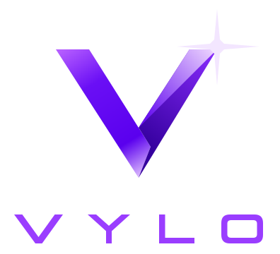
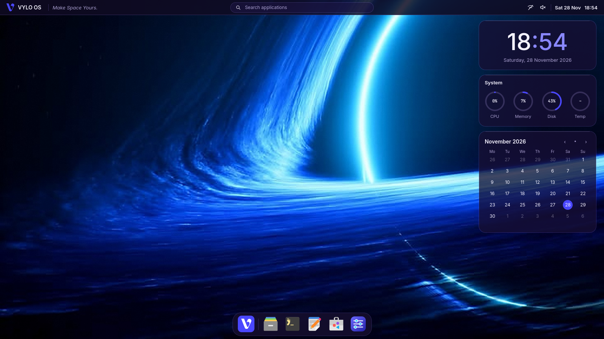
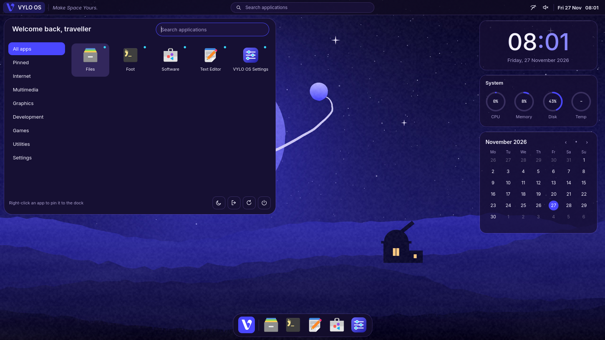
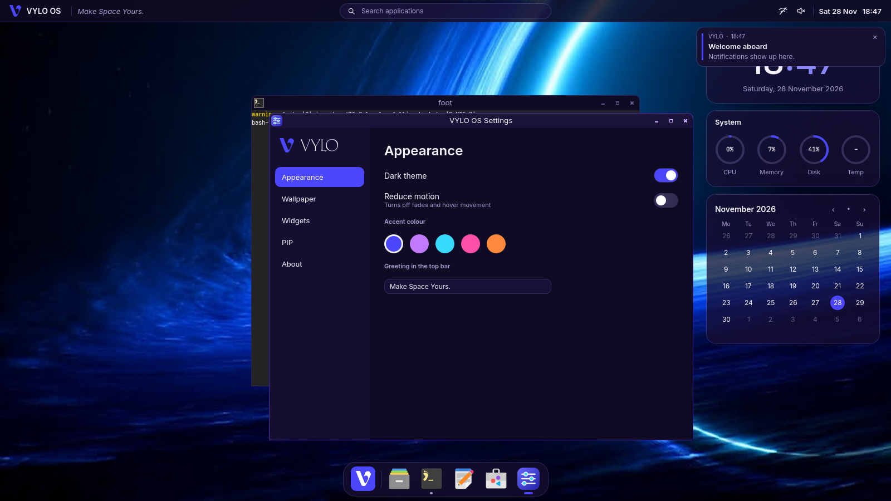
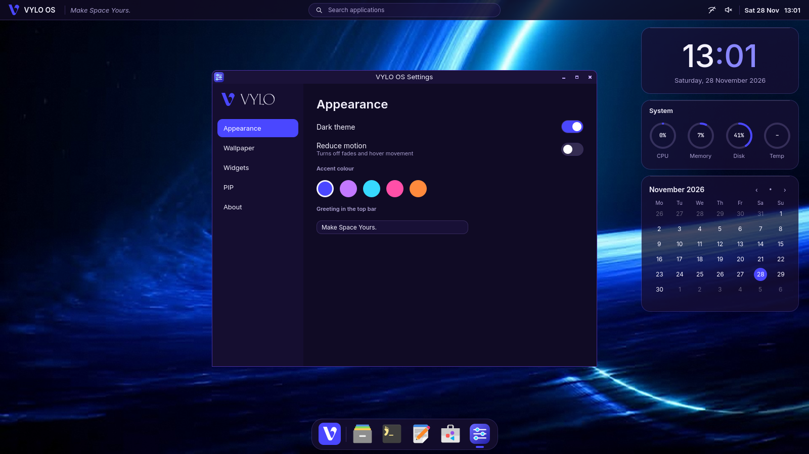
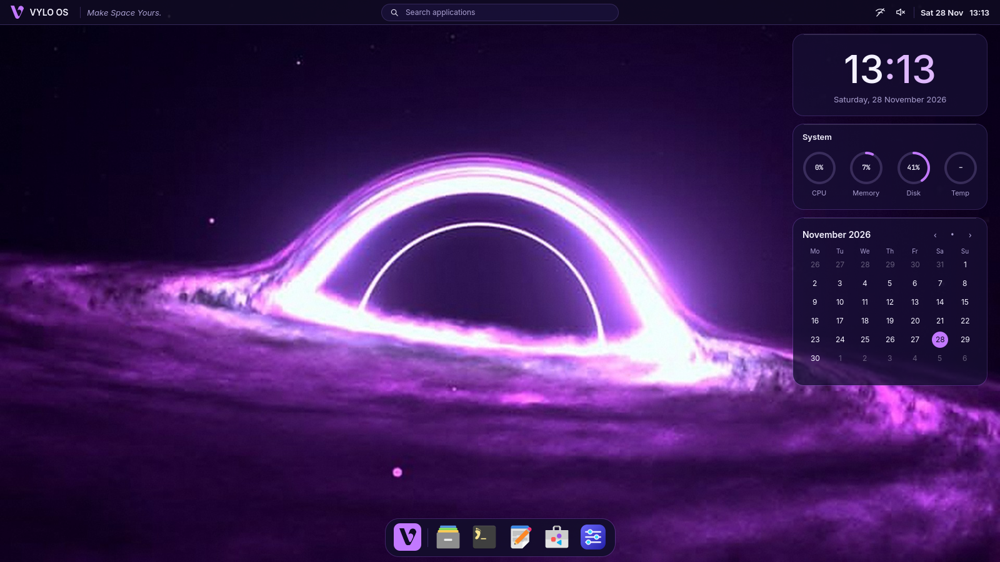
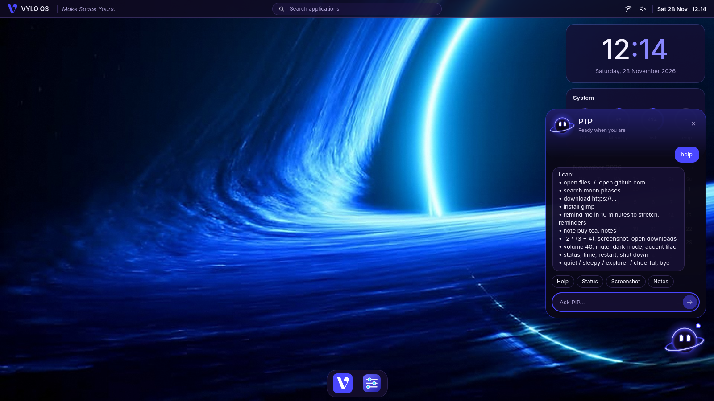

<p align="center">
  <picture>
    <source media="(prefers-color-scheme: dark)" srcset="assets/brand/vylo-logo-dark.svg">
    
  </picture>
</p>

<p align="center"><b>Make Space Yours.</b></p>

VYLO is a Linux system built on Fedora, with its own desktop written in Qt and
QML. Everything that goes into it is in this repository, so you can read it,
change it and build your own ISO.

**It is early.** It runs in virtual machines. It has not been tried on real
hardware, so don't put it on a computer you rely on yet.



The screenshots on this page are taken by an automated run of the desktop on
Fedora 44, in a headless screen with no sound card or network adapter.

## What the desktop does today

- **Top bar** with search, network, volume, battery and clock
- **Orbit Dock** showing pinned apps and open windows. Click to switch or
  minimise, middle click for a new window, right click to pin or close
- **Constellation**, the app launcher, with search and categories
  (`Super` + `Space`)
- **Notifications** with a short history and Do not disturb
- **Widgets** for time, system load and calendar
- **Themes:** dark or light, five accent colours. The logo and the Orbit hills
  wallpaper change colour with the accent

| Launcher | Open windows and notifications |
| --- | --- |
|  |  |
| **Settings** | **Lilac accent** |
|  |  |

## First start

The live image opens a welcome window offering **Install VYLO** or **Try it
first**. An installed system asks once for a theme and colour.

In virtual machines VYLO draws the pointer itself and, on adapters known to show
a black screen, draws everything in software. To force that anywhere, add
`vylo.safegraphics` to the kernel command line.

## Installing

The installer carries the VYLO name, mark and colours.

1. Start the live image and choose **Install VYLO** in the welcome window.
2. Follow the installer: language, disk (with optional encryption) and your
   user account.
3. Restart, remove the installation media and sign in.

Each accent colour has its own space wallpaper. See
[assets/wallpapers](assets/wallpapers/README.md) about their licence.

## PIP (optional)



PIP is a small helper that sits in the corner. He is not on the ISO. Install him
only if you want him:

```bash
sudo dnf install ./vylo-pip-*.rpm   # from a "PIP package" run on the Actions tab
vylo-pip                            # or switch him on in Settings
sudo dnf remove vylo-pip            # removes him completely
```

Type things like `open files`, `open github.com`, `search moon phases`,
`download https://...`, `install gimp`, `remind me in 10 minutes to stretch`,
`note buy tea`, `12 * 7`, `screenshot` or `open downloads`.
He asks before downloading or shutting down, never runs terminal commands and
never opens what he downloads. He understands set phrases (it is not an AI). He
runs as your user and is not sandboxed. The package is not signed yet.

## Not built yet

Wi-Fi and Bluetooth controls in the desktop (the Network and Bluetooth apps are
included), movable widgets, themes you can export, the connected-star view in
the launcher, Spaces, the Pulse monitor and a first-run guide. Space Grotesk, the planned heading font, is not packaged by Fedora, so
headings use Inter unless you install it.

## Editions

| Edition | Desktop | Build name |
| --- | --- | --- |
| VYLO | The VYLO desktop | `vylo` |
| GNOME | GNOME | `gnome` |
| Plasma | KDE Plasma | `plasma` |

All three use the [Helium](https://helium.computer) browser (beta software, from
its own package repository). Plasma also includes Firefox.

## Get it

Every push builds the ISOs on GitHub. Open the
[Actions tab](https://github.com/spaceayyat/MyOS/actions), pick a successful
**Build VYLO ISO** run and download `VYLO-ISO-vylo`, `VYLO-ISO-gnome` or
`VYLO-ISO-plasma`. Check the file against `SHA256SUMS`, then boot it in a
virtual machine with 6 GB of memory and a 40 GB empty disk.
The [install guide](docs/install.md) has the steps.

To build one yourself, with Docker or root Podman:

```bash
sudo VYLO_EDITION=vylo scripts/build-in-container.sh    # ISO appears in output/iso/
```

## How it is tested

For each edition, virtual machines boot the ISO (BIOS, UEFI and Secure Boot) and
install it to a blank disk, with and without encryption. Check the latest run
for current results. The graphical installer screens and real hardware are not
covered.

## Security

SELinux stays enforcing, the firewall is on, packages are signature checked, the
root account is locked and the SSH server is off. Automatic login exists only on
the live ISO. See [security](docs/security.md).

## Where things are

| Path | What |
| --- | --- |
| `desktop/`, `shared/` | The desktop and Settings |
| `image/kiwi` | Packages, services and editions |
| `image/config/` | Files copied into the system |
| `assets/brand` | Logo files |
| `scripts/`, `tests/` | Building and testing |

## License

[MIT](LICENSE) for the files in this repository, except the
[cosmos wallpapers](assets/wallpapers/README.md).  Software inside the ISOs keeps
its own licences. VYLO is not affiliated with or endorsed by the Fedora Project.
