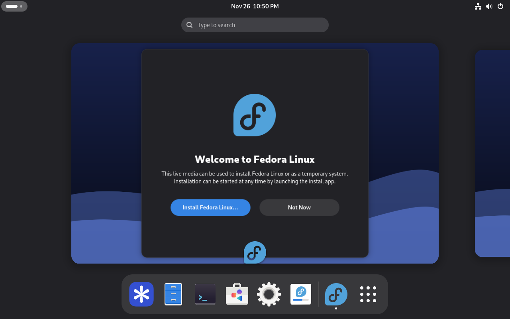
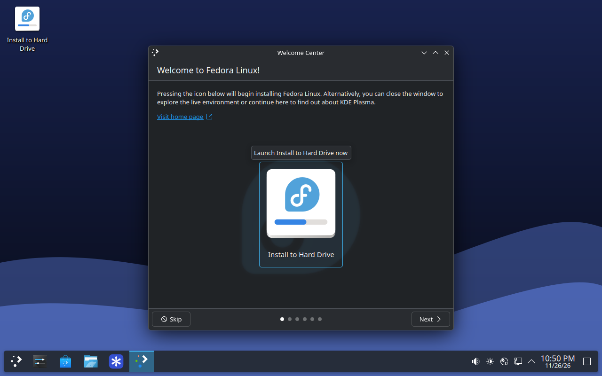
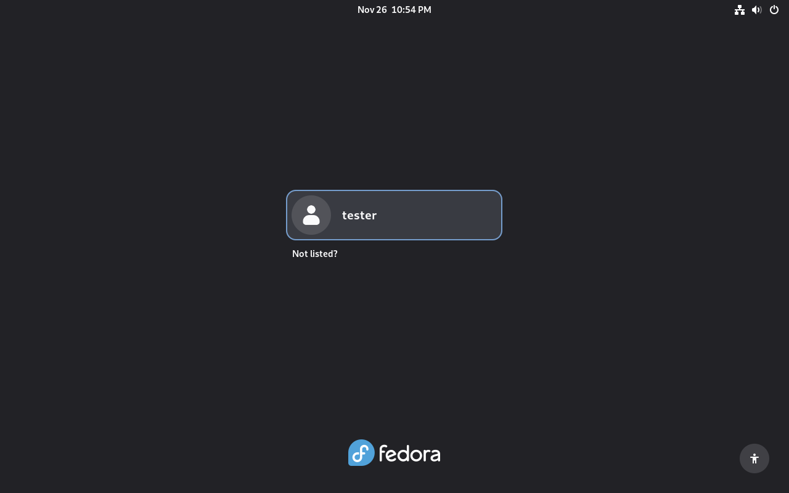
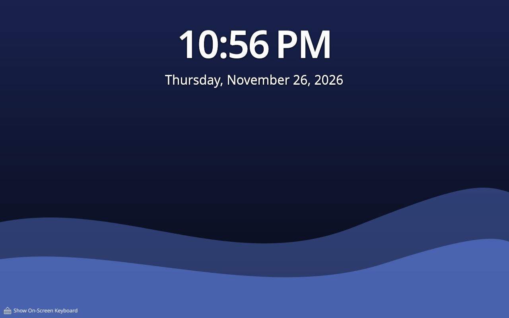
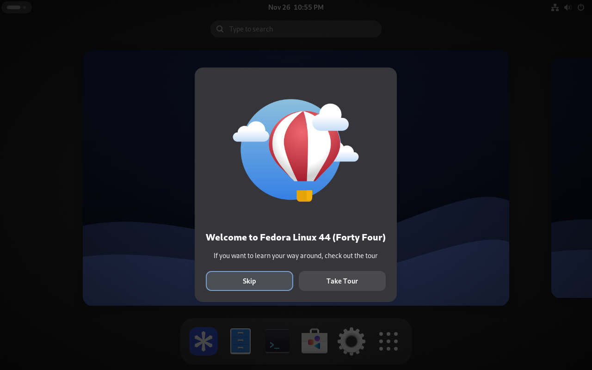
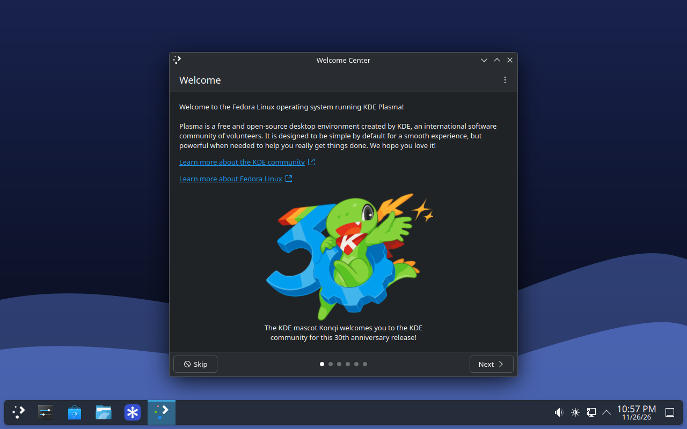

<p align="center"></p>

<p align="center">
An open-source, Fedora-based desktop that you can read, change and rebuild yourself.
</p>

<p align="center">
<a href="https://github.com/spaceayyat/MyOS/releases">Download</a> ·
<a href="docs/install.md">Install</a> ·
<a href="docs/customization.md">Customize</a> ·
<a href="docs/security.md">Security</a> ·
<a href="CHANGELOG.md">Changelog</a>
</p>

> **Preview software.** Try it in a virtual machine before using it anywhere else.

## The idea

An operating system should not be a black box. In VYLO, the whole system is
described by files in this repository: which packages go in, which services
start, how the desktop looks. Change a file, push, and GitHub Actions builds a
new ISO and tests it in virtual machines.

- **Fedora underneath.** Fedora 44 packages, signed and SELinux enforcing.
- **Your choice of desktop.** GNOME is the main edition; KDE Plasma is the second.
- **Tested, not assumed.** Each push boots the ISOs and installs them to a
  virtual disk.
- **Room to experiment.** An optional desktop shell written in Qt 6 and QML lives
  in this repository.

## Screenshots

Taken automatically from the virtual machines that tested the release.

| GNOME, live | KDE Plasma, live |
| --- | --- |
|  |  |
| **GNOME, login screen** | **KDE Plasma, login screen** |
|  |  |
| **GNOME, installed** | **KDE Plasma, installed** |
|  |  |

## Editions

| | GNOME (main) | KDE Plasma |
| --- | --- | --- |
| Default browser | [Helium](https://helium.computer) | Helium |
| Other browser | none | Firefox |
| Files, terminal | Files, Ptyxis | Dolphin, Konsole |
| Editor | Text Editor | Kate |
| Software store | GNOME Software | Discover |
| Documents, images | Papers, Loupe | Okular, Gwenview |
| Customize with | Tweaks, Extensions | System Settings, global themes |

Helium is beta software from the project's own `imput/helium` package repository.

## Features

- Live session you can try without installing
- Anaconda installer, with optional LUKS disk encryption
- btrfs by default, with a snapper configuration for undoing file changes
- SELinux enforcing, firewalld on, SSH server off, root account locked
- Daily automatic **security** updates on installed systems (not for Helium)
- Flatpak, printing, Bluetooth, PipeWire audio and common Wi-Fi firmware
- VYLO wallpaper with light and dark variants

## Download

Get the ISOs from the [Releases page](https://github.com/spaceayyat/MyOS/releases):

- **GNOME:** [VYLO-0.3.0-preview.1-x86_64.iso](https://github.com/spaceayyat/MyOS/releases/download/v0.3.0-preview.1/VYLO-0.3.0-preview.1-x86_64.iso)
- **KDE Plasma:** download both `.part` files and
  [join them](docs/install.md#get-and-verify-the-iso)
- **Checksums:** [SHA256SUMS](https://github.com/spaceayyat/MyOS/releases/download/v0.3.0-preview.1/SHA256SUMS)

## Requirements

A 64-bit Intel or AMD computer or VM. The automated tests use **6 GB of RAM** and
a **40 GB disk**; smaller sizes have not been tested.

## Install

Start the live system, open **Install to Hard Drive**, pick a disk, create your
user and reboot. Full steps: [install guide](docs/install.md). The installer
erases or resizes the disk you choose, so back up first.

## Build it yourself

On GitHub, the **Build VYLO ISO** workflow runs on every push; download the
`VYLO-ISO-gnome` or `VYLO-ISO-plasma` artifact. Locally, with Docker or root
Podman:

```bash
sudo scripts/build-in-container.sh                        # GNOME, in output/iso/
sudo VYLO_EDITION=plasma scripts/build-in-container.sh    # KDE Plasma
```

## Testing

| Test (QEMU, both editions) | What it checks |
| --- | --- |
| Live boot: BIOS, UEFI, Secure Boot | Desktop, network, audio and Bluetooth services, printing, SELinux, firewall, locked root, applications, Helium |
| Install: plain and encrypted (UEFI) | Installation, first boot, login, applications, network, snapshot undo, update command, reboot |

Run the quick checks locally:

```bash
tests/lint.sh                                    # needs shellcheck
for t in tests/unit/test_*.sh; do "$t"; done     # needs bash, python3, g++
```

## Known limitations

- The graphical installer screens are not tested; automated installs run in text mode.
- Real hardware (graphics, Wi-Fi, Bluetooth, printers, suspend) is untested.
- Installed systems are tested with UEFI only, not BIOS or Secure Boot.
- Automatic updates do not cover Helium: its repository has no security advisories.
- Booting an older snapshot from the boot menu is not supported.
- The optional VYLO shell is not covered by the desktop tests.
- No custom welcome app, boot splash, GRUB theme or login screen theme yet.
- Fedora names and logos still appear in places. VYLO is not affiliated with or
  endorsed by the Fedora Project.

## Roadmap

1. Test the graphical installer and real hardware.
2. VYLO branding for boot, login and welcome screens.
3. A VYLO customization app.
4. Snapshot recovery from the boot menu.
5. A bootc image as an additional output.

Details: [roadmap](docs/roadmap.md).

## Repository layout

| Path | Purpose |
| --- | --- |
| `image/kiwi` | ISO description: packages, services, editions |
| `image/config/rootfs*` | Files copied into the image |
| `desktop/`, `shared/` | Optional VYLO Shell and Settings (Qt 6 / QML) |
| `scripts/`, `tests/` | Build and test |
| `image/Containerfile` | Early bootc experiment, not built by CI |

## License

[MIT](LICENSE) for the files in this repository. The software inside the ISOs
keeps its own licenses.
